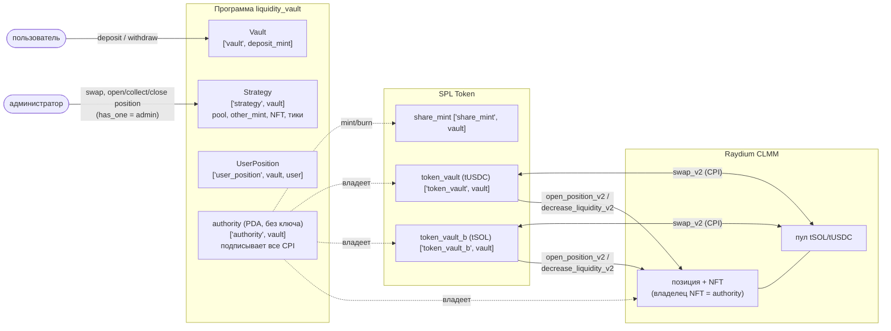

# Liquidity Vault

Учебный DeFi-vault на Solana (Anchor). Сквозной проект курса, недели 8–15.

Пользователи вносят токены в общий «котёл» и получают **share-токены**, квитанцию о своей доле. Администратор управляет стратегией (обмен на Raydium, позиция в CLMM-пуле), но **не может забрать токены**: ими владеет PDA программы.

> Работаем только в devnet и localnet. Ключи и seed-фразы в репозиторий не попадают (см. `.gitignore`).

## Что делает продукт

1. **Пользователь** подключает Phantom или Solflare (devnet), вносит tUSDC и получает share-токены. Share — доля в общем котле: когда vault зарабатывает, каждый share стоит больше tUSDC. При выводе пользователь сжигает share и забирает свою долю.
2. **Администратор (стратег)** размещает средства vault в CLMM-пуле Raydium: меняет часть tUSDC на tSOL, открывает позицию в ценовом диапазоне, собирает комиссии, закрывает и переставляет позицию (ребалансировка).
3. **Деньгами владеет программа.** Хранилища, share-токен и NFT позиции принадлежат PDA `authority` без приватного ключа. Администратор может только запускать стратегию, а программа сама проверяет, что токены двигаются лишь между хранилищами vault и пулом.

Результат в devnet: vault начал с 1100 tUSDC на 1000 share, поработал в пуле (недели 12–13) и закончил с **1108.22 tUSDC**. Цена share выросла с 1.1000 до **1.1082**.

## Как запустить

Нужны Rust, Solana CLI, Anchor 1.2.2, Node 20+ и Yarn.

```bash
yarn install
yarn app            # веб-интерфейс: http://localhost:5173
```

Откройте страницу, переключите кошелёк (Phantom или Solflare) на **Devnet**, возьмите немного devnet SOL на faucet.solana.com и получите тестовые tUSDC от администратора: `yarn mint-test <ваш_адрес> 1000`. Дальше: «Открыть карточку» → «Внести» → «Вывести». Вкладка «Администратор» работает только с кошельком админа.

Программа, тесты и скрипты недель:

```bash
anchor build
anchor test --provider.cluster localnet --validator legacy   # 9 интеграционных тестов
cargo test -p liquidity-vault --lib                        # юнит-тесты математики долей
anchor deploy --provider.cluster devnet
yarn week08 … yarn week13                                   # сценарии недель в devnet
yarn app:build                                              # production-сборка интерфейса в app/dist
```

## Адреса в devnet

| Что | Адрес |
|---|---|
| Программа `liquidity_vault` | [`oZTAvFts97FCp3ninxy5JTa57adEogs8V48PFMvstcY`](https://explorer.solana.com/address/oZTAvFts97FCp3ninxy5JTa57adEogs8V48PFMvstcY?cluster=devnet) |
| Vault | [`EZEuHcmq7UKLjGNTJar9BYdC9LfVUqLy2oDUXZ1F8s7d`](https://explorer.solana.com/address/EZEuHcmq7UKLjGNTJar9BYdC9LfVUqLy2oDUXZ1F8s7d?cluster=devnet) |
| PDA authority | [`EfiKYtKRk38vz9Zttxk1H6jrVfL6MGTn2EiupGVxzJbR`](https://explorer.solana.com/address/EfiKYtKRk38vz9Zttxk1H6jrVfL6MGTn2EiupGVxzJbR?cluster=devnet) |
| Share-токен | [`9WGAAQvBABS62PzNcyuWGbgPuyPz2twF3sMndRUTW36R`](https://explorer.solana.com/address/9WGAAQvBABS62PzNcyuWGbgPuyPz2twF3sMndRUTW36R?cluster=devnet) |
| Хранилище tUSDC / tSOL | [`H7wkWA…io17`](https://explorer.solana.com/address/H7wkWAuEQoqU7X4oFsMiDYdHwmsnT5Mir6cLezuyio17?cluster=devnet) / [`token_vault_b`](deployments/devnet.json) |
| Strategy | см. `strategy` в [`deployments/devnet.json`](deployments/devnet.json) |
| tUSDC / tSOL | [`CufWmi…fLiAK`](https://explorer.solana.com/address/CufWmiDiJsq9JjGSK69by59X4Sou5eJDLUrG3mYfLiAK?cluster=devnet) / [`4cGUJ5…bpDbvb`](https://explorer.solana.com/address/4cGUJ55Jo9ms2aJN6xJ7hknc7vFfpRBymoZU3rbpDbvb?cluster=devnet) |
| CLMM-пул Raydium tSOL/tUSDC | [`ALEGmaWrZyPTfiwdD1hDQxnx5SEXgSjVpUfxE43dmeHM`](https://explorer.solana.com/address/ALEGmaWrZyPTfiwdD1hDQxnx5SEXgSjVpUfxE43dmeHM?cluster=devnet) |
| Администратор | [`A8KgRCLXAqAEKrxjYr3mgforwTMXQrBKk7bEVZ8FLU6k`](https://explorer.solana.com/address/A8KgRCLXAqAEKrxjYr3mgforwTMXQrBKk7bEVZ8FLU6k?cluster=devnet) |

Все адреса машиночитаемо лежат в [`deployments/devnet.json`](deployments/devnet.json). Веб-интерфейс берёт их оттуда.

## Схема аккаунтов (итоговая)



## Кто что сделал

| Участник | Вклад |
|---|---|
| [dusenbekdanira26-hash](https://github.com/dusenbekdanira26-hash) | вся работа: программа (недели 8–13), тесты, скрипты devnet, пул и позиции Raydium, веб-интерфейс, README |

Каждая неделя — отдельный коммит в истории репозитория.

---

## Неделя 8. Каркас vault

### Схема аккаунтов


| Аккаунт | Адрес (seeds) | Владелец (owner) | Что хранит | Зачем |
|---|---|---|---|---|
| `Vault` | `["vault", deposit_mint]` | программа vault | admin, deposit_mint, share_mint, token_vault, total_deposited, bumps | настройки и общий учёт |
| `authority` | `["authority", vault]` | System Program, без данных | — | «подпись» vault: PDA без приватного ключа, подписывать за неё может только программа (`invoke_signed`) |
| `share_mint` | `["share_mint", vault]` | Token Program | mint, mint authority = `authority` | share-токен выпускает только программа, а не человек |
| `token_vault` | `["token_vault", vault]` | Token Program | token account, authority = `authority` | физически хранит внесённые токены |
| `UserPosition` | `["user_position", vault, user]` | программа vault | owner, vault, deposited | карточка пользователя. Адрес вычисляется из адреса пользователя, поэтому список пользователей хранить не нужно |

### Инструкции

- `initialize_vault`: один раз создаёт `Vault`, `share_mint` и `token_vault`.
- `open_user_position`: пользователь создаёт свою `UserPosition`.

### Devnet

| Что | Адрес |
|---|---|
| Программа | [`oZTAvFts97FCp3ninxy5JTa57adEogs8V48PFMvstcY`](https://explorer.solana.com/address/oZTAvFts97FCp3ninxy5JTa57adEogs8V48PFMvstcY?cluster=devnet) |
| Vault (настройки) | [`EZEuHcmq7UKLjGNTJar9BYdC9LfVUqLy2oDUXZ1F8s7d`](https://explorer.solana.com/address/EZEuHcmq7UKLjGNTJar9BYdC9LfVUqLy2oDUXZ1F8s7d?cluster=devnet) |
| authority (PDA) | [`EfiKYtKRk38vz9Zttxk1H6jrVfL6MGTn2EiupGVxzJbR`](https://explorer.solana.com/address/EfiKYtKRk38vz9Zttxk1H6jrVfL6MGTn2EiupGVxzJbR?cluster=devnet) |
| Share-токен | [`9WGAAQvBABS62PzNcyuWGbgPuyPz2twF3sMndRUTW36R`](https://explorer.solana.com/address/9WGAAQvBABS62PzNcyuWGbgPuyPz2twF3sMndRUTW36R?cluster=devnet) |
| Хранилище токенов | [`H7wkWAuEQoqU7X4oFsMiDYdHwmsnT5Mir6cLezuyio17`](https://explorer.solana.com/address/H7wkWAuEQoqU7X4oFsMiDYdHwmsnT5Mir6cLezuyio17?cluster=devnet) |
| Карточка пользователя | [`9SoccM8m6bmkcdN9cFCTohWf9iLyKQgW7ypTT7YHbuvj`](https://explorer.solana.com/address/9SoccM8m6bmkcdN9cFCTohWf9iLyKQgW7ypTT7YHbuvj?cluster=devnet) |
| Тестовый токен (deposit_mint) | [`CufWmiDiJsq9JjGSK69by59X4Sou5eJDLUrG3mYfLiAK`](https://explorer.solana.com/address/CufWmiDiJsq9JjGSK69by59X4Sou5eJDLUrG3mYfLiAK?cluster=devnet) |
| Администратор | [`A8KgRCLXAqAEKrxjYr3mgforwTMXQrBKk7bEVZ8FLU6k`](https://explorer.solana.com/address/A8KgRCLXAqAEKrxjYr3mgforwTMXQrBKk7bEVZ8FLU6k?cluster=devnet) |

Транзакции:
- `initialize_vault`: [63dodX9g…rEz11v](https://explorer.solana.com/tx/63dodX9ggommShiZHJKaPpQWcCKPt1eRCAUy1LnD9XnESYkm7ff7WPJNgAK5CoFpf7kMnGdsgEHANZ3AVfrEz11v?cluster=devnet)
- `open_user_position`: [43SpFDPV…uyVp4kce](https://explorer.solana.com/tx/43SpFDPVKo5stUsbWWoVWUNDuT5kKMtUpw7VFRoF9mHSEMfJCD9Z2LVvydAZ9P5QnPgkpmFNg3HQBFTmuyVp4kce?cluster=devnet)

Тесты на localnet: `anchor test --provider.cluster localnet --validator legacy` проходят (2 passing).

### Проверьте себя

**Почему share-токен выпускает программа, а не администратор?**
Mint authority share-токена — это PDA `authority`. Если бы выпуском управлял человек, он мог бы напечатать себе share-токены и забрать чужую долю. Программа выпускает их только по правилу из кода (при депозите и строго пропорционально).

**Что такое PDA и почему у неё нет приватного ключа?**
PDA (Program Derived Address) — адрес, который вычисляется из seeds и `program_id`. Его специально подбирают так, чтобы он не лежал на кривой ed25519 (для этого нужен `bump`). Поэтому соответствующего приватного ключа не существует. «Подписать» за PDA может только программа, из которой адрес выведен, через `invoke_signed` с теми же seeds.

**Как найти карточку конкретного пользователя?**
Вычислить адрес: `PublicKey.findProgramAddressSync(["user_position", vault, user], programId)`. Хранить список пользователей не нужно.

---

## Неделя 9. Депозит и share-токены

### Правило расчёта

```
если share ещё не выпущено:  shares = amount                       (1:1)
иначе:                       shares = amount × total_shares / total_assets
```

- `total_assets`: сколько токенов сейчас лежит в `token_vault`, включая заработанное. `total_shares` — supply `share_mint`.
- Расчёт ведётся в `u128`, округление вниз в пользу vault. Код в [`math.rs`](programs/liquidity-vault/src/math.rs), там же юнит-тесты.
- Депозит 0 запрещён (`ZeroAmount`). Если share получается 0, депозит тоже отклоняется (`ZeroShares`).

### Инструкция `deposit(amount)`

1. Посчитать share **до** перевода.
2. `transfer_checked`: токены пользователя → `token_vault`. Подписывает **пользователь**.
3. `mint_to`: share-токены → ATA пользователя (создаётся при первом депозите, `init_if_needed`). Подписывает **программа** от имени PDA `authority` (`invoke_signed` с seeds `["authority", vault, bump]`).
4. Учёт: `vault.total_deposited += amount`, `user_position.deposited += amount`.

### Devnet: пример из методички

Скрипт [`scripts/week09-deposit.ts`](scripts/week09-deposit.ts) (`yarn week09`):

| Шаг | В vault | Share выпущено | Мои share | Транзакция |
|---|---|---|---|---|
| Депозит 1000 | 1000 | 1000 | 1000 | [58wd61GQ…JsUe3g](https://explorer.solana.com/tx/58wd61GQYTD819ebRH1SwshgKYbcQd7rTsS7XZDdjUGQJ6JrYRVUfj8fEEZP9tW8iF4prr2w3BzczfYYn4JsUe3g?cluster=devnet) |
| Vault «заработал» +100 (перевод в хранилище) | 1100 | 1000 | 1000 | [2DzFz5F1…C9t3VA](https://explorer.solana.com/tx/2DzFz5F11S6UgGpvWi7f9xkVts4X63be2LKYySJWfRDkxW4xnG2HLZ5WdxqSg1AE626nLQzASATXCprKN3C9t3VA?cluster=devnet) |
| Депозит 110 → **100 share** | 1210 | 1100 | 1100 | [4FcbDMu4…qTqX3QK](https://explorer.solana.com/tx/4FcbDMu4UfytsEsJUbzXEStKf5nrGs6yidpS51dT3NdUNarb9Q1cNsYFhfExAD5oZjmvmovwkPKvanvRSqTqX3QK?cluster=devnet) |

После этого `vault.total_deposited = 1110`, `user_position.deposited = 1110`. Share-токены лежат на ATA [`userShareAccount`](deployments/devnet.json).

### Проверьте себя

**Почему поздний вкладчик может получить share-токенов меньше, чем внёс токенов?**
Share — это доля котла, а не сумма. Когда vault заработал, каждый share «стоит» больше одного токена (1100 / 1000 = 1.1). Поэтому за 110 токенов дают 100 share. Иначе новичок получил бы часть дохода, который заработали до него.

**Почему перевод подписывает пользователь, а выпуск share-токенов — программа?**
Токены пользователя может двигать только их владелец, поэтому его подпись передаётся в CPI к Token Program. Mint authority share-токена — PDA `authority`, и подписать за неё может только наша программа через `invoke_signed`. Поэтому share нельзя напечатать в обход правила расчёта.

**Какие программы участвовали в транзакции депозита?** (первый депозит, `solana confirm -v`)

```
oZTAvF…stcY  (наша программа)            invoke [1]  Instruction: Deposit
  ATokenGPvb… (Associated Token Program)  invoke [2]  создание ATA для share
    Tokenkeg… (Token Program)             invoke [3]
    11111111… (System Program)            invoke [3]  выделение места под аккаунт
    Tokenkeg…                             invoke [3]
    Tokenkeg…                             invoke [3]
  Tokenkeg…   (Token Program)             invoke [2]  transfer_checked: user → token_vault
  Tokenkeg…   (Token Program)             invoke [2]  mint_to: share → user
```

Во втором депозите ATA уже есть, поэтому остаются только два вызова Token Program.

---

## Неделя 10. CPI и вывод из vault

### Инструкция `withdraw(shares)`

1. Проверить: `shares > 0` и у пользователя есть столько share (`InsufficientShares`).
2. Посчитать: `amount = shares × total_assets / total_shares` (u128, округление вниз).
3. CPI `burn`: сжечь share пользователя. Подписывает **пользователь**, его подпись передаётся дальше по цепочке.
4. CPI `transfer_checked`: `token_vault` → пользователь. Подписывает **программа** от имени PDA `authority` (`CpiContext::new_with_signer` с seeds `["authority", vault, bump]`).
5. Учёт: `deposited` уменьшается пропорционально возвращённой доле: `deposited × shares / user_shares`.

### Devnet

Скрипт [`scripts/week10-withdraw.ts`](scripts/week10-withdraw.ts) (`yarn week10`).
Транзакция: [2QcDuz1G…hdJx9AStU7z4](https://explorer.solana.com/tx/2QcDuz1Gr9MSEZeXx98pPfTjT2R8GfxYAp1JHc2mowjFYrLd7Jk5bysRFieWtmA7syvBySRY8NDRhdJx9AStU7z4?cluster=devnet)

| | В vault | Share выпущено | Мои share | Мои токены |
|---|---|---|---|---|
| до | 1210 | 1100 | 1100 | 8790 |
| после `withdraw(100 share)` | 1100 | 1000 | 1000 | 8900 (**+110**) |

Пользователь вернул 100 share и получил 110 токенов: это его доля в доходе +100 с недели 9.

### Какие CPI-вызовы видны в транзакции вывода

В Explorer, в разделе **Inner Instructions** у инструкции нашей программы `oZTAvF…stcY`, два вызова Token Program:

| # | Вызов | Кто подписал (`authority`) | Что сделано |
|---|---|---|---|
| 1 | `burn` | `A8KgRC…LU6k`, кошелёк **пользователя** | сожжено 100 share с его ATA `DYtcEM…UrzL` |
| 2 | `transferChecked` | `EfiKYt…zJbR`, **PDA authority** vault | 110 токенов из `token_vault` `H7wkWA…io17` → пользователю `7jA2Ds…Qc8P` |

Подпись PDA в транзакции не видна: её нет среди подписей. Token Program принимает `authority` как подписанта, потому что наша программа вызвала его через `invoke_signed` с правильными seeds.

### Проверьте себя

**Что такое CPI и зачем он нужен?**
Cross-Program Invocation — вызов одной программы из другой внутри той же транзакции. Наша программа сама не двигает токены: балансы хранит Token Program, и менять их может только она. Vault «просит» её сделать `transfer`, `mint_to` или `burn`. Так же на неделях 12–13 vault будет вызывать Raydium.

**Когда подписывает пользователь, а когда программа?**
Когда двигаются токены пользователя (перевод при депозите, сжигание share при выводе), подписывает пользователь. Его подпись из транзакции передаётся в CPI. Когда двигаются токены vault или выпускаются share, подписывает программа от имени PDA `authority` через `invoke_signed`.

**Почему администратор не может просто забрать токены из vault своей подписью?**
Владелец `token_vault` — PDA `authority`, а не администратор. У PDA нет приватного ключа, и подписать за неё может только наша программа. В коде программы нет инструкции, которая отдаёт токены кому-то кроме пользователя, сжигающего свои share. Тест `администратор не может забрать токены из хранилища своей подписью` проверяет это: Token Program отклоняет такой перевод с ошибкой `owner does not match`.

---

## Неделя 11. AMM и концентрированная ликвидность

Скрипт [`scripts/week11-pool.ts`](scripts/week11-pool.ts) (`yarn week11`) использует официальный Raydium SDK v2. Он устроен по образцу `raydium-sdk-V2-demo/src/clmm/createPool.ts` и `createPosition.ts`, настройка devnet лежит в [`scripts/raydium.ts`](scripts/raydium.ts).

### Тестовые токены

| Токен | Знаков | Mint | Роль |
|---|---|---|---|
| **tUSDC** | 6 | [`CufWmi…fLiAK`](https://explorer.solana.com/address/CufWmiDiJsq9JjGSK69by59X4Sou5eJDLUrG3mYfLiAK?cluster=devnet) | токен vault с недели 8 (его принимает vault) |
| **tSOL** | 9 | [`4cGUJ5…bpDbvb`](https://explorer.solana.com/address/4cGUJ55Jo9ms2aJN6xJ7hknc7vFfpRBymoZU3rbpDbvb?cluster=devnet) | второй токен пула |

Оба токена наши: mint authority — кошелёк администратора. Себе выпущено 1000 tSOL и 100 000 tUSDC. Первым токеном пула специально взят токен vault: на неделе 12 vault будет менять через этот пул часть tUSDC на tSOL.

### CLMM-пул Raydium (devnet)

| Что | Адрес / значение |
|---|---|
| Программа Raydium CLMM (devnet) | [`DRayAUgENGQBKVaX8owNhgzkEDyoHTGVEGHVJT1E9pfH`](https://explorer.solana.com/address/DRayAUgENGQBKVaX8owNhgzkEDyoHTGVEGHVJT1E9pfH?cluster=devnet) |
| **Пул tSOL/tUSDC** | [`ALEGmaWrZyPTfiwdD1hDQxnx5SEXgSjVpUfxE43dmeHM`](https://explorer.solana.com/address/ALEGmaWrZyPTfiwdD1hDQxnx5SEXgSjVpUfxE43dmeHM?cluster=devnet) |
| Fee-конфиг | [`CD4aJt…Q1qu`](https://explorer.solana.com/address/CD4aJtX11cqTCAc83nxSPkkh5JW2yjD6uwHeovjqQ1qu?cluster=devnet): комиссия **0.25%**, tickSpacing **60** |
| mintA / mintB | tSOL / tUSDC (Raydium сортирует mint по адресу) |
| Хранилища пула A / B | [`BT2TvT…miSi`](https://explorer.solana.com/address/BT2TvTxMSKcvB5JUnQdwW79TzHcMRgrdpbJVdUqwmiSi?cluster=devnet) / [`J96HTy…WAK`](https://explorer.solana.com/address/J96HTySQwiVTeZTjiotf72cKaVPggUxjFyGATwFaRWAK?cluster=devnet) |
| Observation (оракул) | [`8JrsDR…ReZS`](https://explorer.solana.com/address/8JrsDRsDraGo4gda2i445zrcALSSVQb7Rf9DvJu3ReZS?cluster=devnet) |
| Tick-array bitmap extension | [`7yfqJJ…6W3v`](https://explorer.solana.com/address/7yfqJJ1DhJM38aXqH6SyofQSxBmguhqWcd5tjnyd6W3v?cluster=devnet) |
| Транзакция создания пула | [mNapqJbv…oexy7Joi1](https://explorer.solana.com/tx/mNapqJbvFmeetvrnBfj8nfyKoeyRGiNePLLEVf9gk9mJmnDLjZ2CHPY9LhPJhchuPkHdqYQG9WU8BKoexy7Joi1?cluster=devnet) |

Все адреса для недель 12–13 сохранены в [`deployments/devnet.json`](deployments/devnet.json).

### Позиция со своего кошелька

| | |
|---|---|
| **Текущая цена пула** | **100 tUSDC за 1 tSOL** (tick −23028) |
| **Выбранный диапазон** | **90 – 110 tUSDC за tSOL** → после выравнивания по шагу 60 тиков: tick −24120 … −22080 ≈ **89.6 – 109.9** |
| Внесено | 10 tSOL + ≈1150 tUSDC |
| NFT позиции | [`8nk5VW…JJkx`](https://explorer.solana.com/address/8nk5VWQSM5S9C8rjNLpieHX4juVn8Fw1ZtamHVXUJJkx?cluster=devnet) |
| Транзакция | [4LC8CgbZ…en28LNU3x](https://explorer.solana.com/tx/4LC8CgbZZH7uRomR8VSZCJc6eiyU1HMVzjNGntYSib8FzkqsunfiessiQibpQKGxJux1AhZBdvkZ7c8en28LNU3x?cluster=devnet) |

**Почему именно ±10%.** Это правило из методички: от текущей цены отступаем вверх и вниз на величину обычного колебания за период. Для пары «SOL/USDC» ±10% — типичное недельное движение. Узкий диапазон (±1–2%) зарабатывает больше, но цена быстро из него выходит, и тогда позиция стоит без дохода. Широкий (×0.5 – ×2) спокойнее, но ликвидность «размазана» и комиссий меньше. ±10% — середина. Ещё одна практическая причина: в пуле пока только наша ликвидность. Достаточно широкий диапазон нужен, чтобы тестовые обмены на неделе 12 не выталкивали цену за его границы с первой сделки.

Почему tUSDC внесено больше, чем 10 × 100 = 1000: в CLMM пропорция зависит от того, где цена внутри диапазона, в «корневой» шкале √P. √100 ближе к √110, чем к √90 в относительных единицах, поэтому tUSDC нужно чуть больше.

### Проверьте себя

**Чем концентрированная ликвидность отличается от простого пула?**
В простом пуле (x·y = k) ликвидность распределена по всем ценам от 0 до ∞, и при обычной цене работает только малая её часть. В CLMM провайдер сам выбирает диапазон [Pa, Pb], и вся его ликвидность работает только там. Поэтому та же сумма даёт гораздо больше глубины около текущей цены и больше комиссий. Каждая позиция отдельная, со своим диапазоном. В Raydium она оформлена как NFT.

**Что происходит с позицией, когда цена выходит за её диапазон?**
Она перестаёт участвовать в обменах и зарабатывать комиссии. Пока цена шла к границе, обменщики забирали из позиции один токен и оставляли другой, поэтому за границей позиция целиком состоит из одного токена. Выше верхней границы — только tUSDC (все tSOL проданы), ниже нижней — только tSOL. Доход вернётся, когда цена вернётся в диапазон или позицию передвинут (ребалансировка).

**Почему узкий диапазон зарабатывает больше, но требует больше внимания?**
Та же сумма на меньшем отрезке цен даёт больше ликвидности L на каждый тик. Доля позиции в каждом обмене выше, поэтому и комиссий больше. Но цена выходит из узкого диапазона чаще, и каждый раз позиция перестаёт зарабатывать, пока администратор её не переставит. Это стоит комиссий сети и обменов.

---

## Неделя 12. Swap через Raydium

### Что добавлено в программу

- **`Strategy`**, PDA `["strategy", vault]`: пул, второй токен, второе хранилище, (позже) NFT позиции. Это отдельный аккаунт, чтобы не менять layout уже созданного в devnet `Vault`.
- **`token_vault_b`**, PDA `["token_vault_b", vault]`: второе хранилище vault для tSOL, владелец — PDA `authority`.
- **`init_strategy`** (только админ): привязывает vault к пулу. Проверяет, что владелец пула — программа Raydium CLMM.
- **`swap(amount_in, min_amount_out, sqrt_price_limit_x64)`** (только админ, `has_one = admin`): CPI `swap_v2` в Raydium.
  - Входное и выходное хранилища обязаны быть хранилищами этого vault, пул — пулом стратегии.
  - `payer` обмена = PDA `authority`, подпись через `invoke_signed`.
  - `other_amount_threshold = min_amount_out`: Raydium сам отменяет обмен, если отдаёт меньше. Поверх этого программа ещё раз сверяет фактически полученное (`SlippageExceeded`).
  - Tick arrays по пути обмена и bitmap extension передаются как `remaining_accounts`.

CPI собирается вручную ([`raydium.rs`](programs/liquidity-vault/src/raydium.rs)): дискриминатор `sha256("global:swap_v2")[..8]` и borsh-аргументы, порядок аккаунтов как в `SwapSingleV2` из [raydium-clmm](https://github.com/raydium-io/raydium-clmm). Крейт CPI из `raydium-cpi-example` привязан к Anchor 0.29, проект — на Anchor 1.2.2, поэтому подключать его не стали.

### Devnet

Скрипт [`scripts/week12-swap.ts`](scripts/week12-swap.ts) (`yarn week12`). Ожидаемую сумму считает симулятор Raydium SDK (`swapInternal`, как в `raydium-sdk-V2-demo/src/clmm/swap.ts`), минимум = ожидаемое − 1%.

| | В vault | Цена пула (tUSDC за tSOL) | Транзакция |
|---|---|---|---|
| `init_strategy` | 1100 tUSDC | 100.0000 | [2PRuk6w2…5q9otZfL](https://explorer.solana.com/tx/2PRuk6w2j9bEqs4t4RDEPaADhN1PuWHBP6kBjiPginzUwpMqw6u7qLYF7MGMEdPXyMx1n9HEpSuGdTZK5q9otZfL?cluster=devnet) |
| ✅ **Обмен 300 tUSDC → tSOL**: ожидали 2.951653 tSOL, минимум 2.922137, **получили 2.951653** | 800 tUSDC + 2.951653 tSOL | **102.7869** (tick −23028 → −22753) | [YGdJMGra…kAwTNk7](https://explorer.solana.com/tx/YGdJMGradw5V1mnbrQBUeap7bFb4gwL9KMqUCragmVgaExdwcmGida7izazotNafKLhvFeUp61bW4B9akAwTNk7?cluster=devnet) |
| ❌ **Обмен 50 tUSDC с минимумом на 5% выше возможного**: отклонён | без изменений | без изменений | [2aTPMNBJ…ywLF7Pjv](https://explorer.solana.com/tx/2aTPMNBJpFmDwuwSsBDBWNLrD3c2tYUT6HvWvfig8CuiiURJhFu9vt2bj99BSZvfoFFQR7iQbQBu5SG6ywLF7Pjv?cluster=devnet) |

Лог отклонённой транзакции:
```
Program log: AnchorError thrown in programs/amm/src/instructions/swap_v2.rs:364.
Error Code: TooLittleOutputReceived. Error Number: 6018.
Program DRayAU…9pfH failed: custom program error: 0x1782
Program oZTAvF…stcY failed: custom program error: 0x1782
```

**Как изменилась цена.** Vault купил tSOL, поэтому tSOL в пуле стало меньше, а tUSDC больше, и цена tSOL выросла с **100.00 до 102.79 (+2.8%)**. Средняя цена сделки: 300 / 2.9517 ≈ **101.64**, это между ценой до и после. Сдвиг заметный, потому что в пуле только одна позиция (≈10 tSOL + 1150 tUSDC): обмен на 300 tUSDC — это около четверти tUSDC в позиции. Цена осталась внутри диапазона 89.6 – 109.9.

### Проверьте себя

**Что такое slippage и как от него защищаются?**
Slippage — разница между ожидаемой ценой и ценой, по которой обмен прошёл на самом деле. Пока транзакция летит в сеть, другие могут сдвинуть цену; ещё её сдвигает сам объём сделки. Защита — минимум, который ты согласен получить (`other_amount_threshold`). Если пул отдаёт меньше, обмен отменяется целиком, и токены не уходят (это видно во второй транзакции). Также можно задать `sqrt_price_limit_x64`, предельную цену, дальше которой обмен не пойдёт.

**Почему цена сдвигается сильнее, если около текущей цены мало ликвидности?**
Обмен «проходит» по тикам: в каждом тике пул отдаёт токены из ликвидности L, которая там есть. Чем меньше L около текущей цены, тем больше тиков нужно пройти, чтобы набрать ту же сумму, и тем дальше уходит цена. В нашем пуле ликвидность одной позиции, поэтому 300 tUSDC сдвинули цену на 2.8%. В пуле с ликвидностью в 100 раз больше сдвиг был бы около 0.03%.

**Почему обмен подписывает программа, а не администратор?**
Токены, которые меняются, лежат в хранилищах vault, а их владелец — PDA `authority`. Подписать за неё может только программа через `invoke_signed`. Администратор лишь запускает инструкцию, и программа проверяет, что это он (`has_one = admin`). Сами токены он не трогает и в своё хранилище вывести их не может: обмен идёт только между двумя хранилищами vault.

---

## Неделя 13. Позиция vault в CLMM-пуле

### Инструкции (только администратор, подписывает PDA `authority`)

| Инструкция | CPI в Raydium | Что делает |
|---|---|---|
| `open_position(tick_lower, tick_upper, ta_lower_start, ta_upper_start, liquidity, amount_0_max, amount_1_max)` | `open_position_v2` | vault отдаёт оба токена в пул и получает **NFT позиции на PDA `authority`**. `amount_*_max` — максимум, который vault готов отдать. Адрес NFT и тики сохраняются в `Strategy`, вторую позицию открыть нельзя (`PositionAlreadyOpen`). |
| `collect_fees()` | `decrease_liquidity_v2(liquidity = 0)` | Raydium выплачивает накопленные комиссии в хранилища vault. Ликвидность остаётся в пуле. |
| `close_position(amount_0_min, amount_1_min)` | `decrease_liquidity_v2(вся ликвидность)` + `close_position` | Ликвидность программа читает прямо из `PersonalPositionState` Raydium (смещение 81). Вывод всей ликвидности не меньше минимумов, затем NFT сжигается, rent возвращается на `authority`. |

PDA `authority` в `open_position` — это ещё и `payer`: она платит rent за аккаунты позиции (mint NFT, ATA, personal position, tick arrays). Поэтому админ один раз пополнил её на 0.2 SOL ([tx](https://explorer.solana.com/tx/3xJEcjTcWH9bsX8gyxYamaLHCNYaU7mNJzHKU36SJJaT4BtHM29Skt5Dn9FsdKG2riKeyn4QQKKCL6Y4JES5kkjb?cluster=devnet)). Аккаунты и CPI — в [`position.rs`](programs/liquidity-vault/src/instructions/position.rs).

### Devnet: сценарий из методички

Скрипт [`scripts/week13-position.ts`](scripts/week13-position.ts) (`yarn week13`), хелперы в [`scripts/position.ts`](scripts/position.ts). Обмены делает отдельный кошелёк «трейдера» [`8MvpgvVb…qwdV`](https://explorer.solana.com/address/8MvpgvVbjJcFFMjooXQQcvsTTwm9tZ31Xc6mQM1dqwdV?cluster=devnet).

**A. Открыть → обмены → собрать комиссии → закрыть**

| Шаг | Результат | Tx |
|---|---|---|
| Старт | цена **102.79**, в vault 2.951653 tSOL + 800 tUSDC | |
| Открыть позицию ±5% | **выбранный диапазон: 97.50 – 107.33** (tick −23280 … −22320), vault отдал **2.892620 tSOL + 362.3562 tUSDC**, NFT [`9Qmgtp…o5QY`](https://explorer.solana.com/address/9QmgtPxtBUTXBH55WsuRygZ9qaAUENmgXHT88GqEo5QY?cluster=devnet) | [5aTUFCGX](https://explorer.solana.com/tx/5aTUFCGXrBWbuuvBUcnBGMmZqYmxstTuZDRJVeHBE4tFpkTf777bjN4nck772DtvyGA3sGm8ysiXkrnFDjNgyePA?cluster=devnet) |
| 6 обменов трейдера: 3 × (200 tUSDC → tSOL), 3 × (2 tSOL → tUSDC) | цена 102.67, внутри диапазона | [1](https://explorer.solana.com/tx/4X9HoLcvLqj8MZAeNZ9rajdvBph3ng2dePRdbHuM76KRpDuHtEUSyttDzoLzEapGLhtLsdxMLmCi2Zkfn7nNj3D9?cluster=devnet) [2](https://explorer.solana.com/tx/3n3zqzNBhJeMiUfx6t9PhBZAnNZajoBkyVrM9Dgwv8ZXv2vA3HhEqSM1LcE4yBGxXZEhZKmfTQXTeexiTCLLt2hJ?cluster=devnet) [3](https://explorer.solana.com/tx/2TxQmgYkRddjW1S9HD4HuLStixDEiUMC36xA4gE1e48HWmdx37QHbu3J5LMwDRfryL6yogsRwEQHWeDqKFGUWDZ5?cluster=devnet) [4](https://explorer.solana.com/tx/26sBBpPouxf6W67pGFVXxDw1SJx1PXGViEMnTFhDq8j3KgYhvU2PoSARnhykjNcYbAUmffsRxUw6Tp11TtKeERiD?cluster=devnet) [5](https://explorer.solana.com/tx/ErXiq4b3cbhK3TFuWXDEjS5W1QfyDtPozRJJQzCsN2VzM2kCnx876UoU7GokcMPmNFP97ycKVmuDFftsDdnCG9R?cluster=devnet) [6](https://explorer.solana.com/tx/5ohthM3qGAzs6cepnVoMYMjzz9dypxexmD2BhLPZQUQ3YokvRY6YjkymfzQvVi1xaT4kfSgXa6NcV7s1DZqaoVkX?cluster=devnet) |
| **Собрать комиссии** | **заработано 0.004891 tSOL + 0.4891 tUSDC** (≈ 0.99 tUSDC) | [h1wXM6Hh](https://explorer.solana.com/tx/h1wXM6HhPtciieEd8X56Hxxug2KSoRHkBE3HgwrNBWMkfnowS2xDHEYv1Yb4BvoHaUi55GwxSSmSJiXZgFYJuWA?cluster=devnet) |
| **Закрыть позицию** (минимум = ожидаемое − 1%: 2.937626 tSOL / 351.1376 tUSDC) | **вернулось 2.967299 tSOL + 354.6844 tUSDC** | [2q3zPu2t](https://explorer.solana.com/tx/2q3zPu2t3jtu3YzP8KijZYZNGNBtBT6qoNRVTWw4HGWP7rLiFT4HKKyeaZwoM392aZzFiDiBhUg5YBVgycqexNR3?cluster=devnet) |

Проверка комиссий: трейдер прогнал 600 tUSDC и 6 tSOL. При комиссии 0.25% пул собрал 1.5 tUSDC и 0.015 tSOL. 12% из них забирает протокол (`protocolFeeRate`), ещё 4% идут в фонд (`fundFeeRate`), провайдерам остаётся 84%: 1.26 tUSDC и 0.0126 tSOL. Эта сумма делится между двумя позициями пропорционально ликвидности около текущей цены. Vault получил 0.4891 / 1.26 ≈ **39%**.

Вернулось tSOL больше, а tUSDC меньше, чем внесли: цена за время позиции немного опустилась (102.79 → 102.67). Позиция «купила» немного tSOL, как и положено CLMM.

**B. Ребалансировка**

| Шаг | Результат | Tx |
|---|---|---|
| Открыть узкую позицию ±3% | диапазон **99.27 – 105.41**, NFT [`w3bDwz…VXE`](https://explorer.solana.com/address/w3bDwz5gLvzz8P7J9ggsbfxDuLNCRSwueeQmxLNJVXE?cluster=devnet) | [7y7RpAyY](https://explorer.solana.com/tx/7y7RpAyYRbWoNr6ZvsRnSLx99hPr1es58Et7zxHGQfTcfywcibQCi5k7hrzGQfyCfQjSewPpd8HztXWuXdQb8L5?cluster=devnet) |
| Трейдер покупает tSOL (3 × 250 tUSDC) | цена **106.83 > 105.41**: позиция **вышла за диапазон** | [1](https://explorer.solana.com/tx/5nhH4p8S1yT4FLKu4HNe2Z3ESWXFYXipKcWpSjxHBTQrDhvaMn8wmLm6BTfWhtZE5yX2G24ukEkii2sLTnxPfWgn?cluster=devnet) [2](https://explorer.solana.com/tx/uPDdnmqhNZMnK5NXz7WdDwF22TvXo7vbyiz91Shxe1mG889P8Yeno7aaHJMsWUjNnv8qyvizdZHJrhYsmCkbNvo?cluster=devnet) [3](https://explorer.solana.com/tx/241u14NQxfdURdAnQ1VfWZkEWSc2c9GXYnH64EBSv7omxn7cA7gFWgAtD5RpF3bTsSpN2H8TLUKoRMwXm9XxreJb?cluster=devnet) |
| Закрыть позицию вне диапазона | вернулось **0 tSOL + 699.4062 tUSDC**: весь tSOL продан по пути вверх | [5iMqLsG6](https://explorer.solana.com/tx/5iMqLsG6KCGV8G2SkyGNkAa7Cz5E3TqVXm1wBap1VDXTrvtQ7btdYAiv6VZcAqQNCb8JgLzDB4GPrVCfpCGzhgTt?cluster=devnet) |
| Vault меняет 150 tUSDC → tSOL (инструкция `swap` недели 12) | в vault 1.451904 tSOL + 952.5092 tUSDC | [JbWnrcXf](https://explorer.solana.com/tx/JbWnrcXfQ2LUjskZm18eEyiSMc2MC1epfcuZtkyjsoJ7vDXpFLrfGa5gf75WsyDRoHon3ADUq9R3wUMKic2kp3D?cluster=devnet) |
| Новая позиция ±5% вокруг новой цены 108.26 | диапазон **102.30 – 113.28**, vault отдал 1.422866 tSOL + 192.3727 tUSDC | [62UqfMKm](https://explorer.solana.com/tx/62UqfMKmkrfU9CrCQUeue5hXKWhBPQBH4wqQhi9rkHfhUxvp3qAkHpJCwuCPXEUDtPk87YEQGVURMUtRF6qUaGu8?cluster=devnet) |

Обмен для ребалансировки ограничен 150 tUSDC. Выше 109.9 в пуле нет ничьей ликвидности, и обмен на ~550 tUSDC Raydium отклонил с `LiquidityInsufficient`. Поэтому новая позиция меньше, а остаток tUSDC ждёт в хранилище.

**C. Подготовка к выводу (упрощение учебной версии)**

Закрыть позицию ([4cEiudDi](https://explorer.solana.com/tx/4cEiudDi5LVheFg7LHtGixWR5qn7SwRmiY2utGrW5PanRu9rhZcFzj5aoJGHMrrZHiHSKNSXp7N3XFQ5urrEdqc4?cluster=devnet)) и обменять весь tSOL обратно в tUSDC ([667afAYQ](https://explorer.solana.com/tx/667afAYQxTjD21H1o7rMvvb2Rm59ZaVMG8bPxstkgk5FXaSb6U7mUAnT5cNu5uw43Lqe6AB9aCn8UQTL49SY4tnh?cluster=devnet)).

**Итог: в vault 1108.2213 tUSDC на 1000 share** (до недели 12 было 1100). Каждый share стоит **1.1082** tUSDC вместо 1.1: прибыль от комиссий и от того, что vault купил tSOL дешевле, чем продал.

> **Ограничение учебной версии.** `deposit` и `withdraw` считают долю только по `token_vault` (tUSDC). Пока средства лежат в позиции или в tSOL, депозит и вывод были бы несправедливыми. Поэтому перед выводом администратор закрывает позицию и меняет tSOL обратно (шаг C). В настоящих продуктах total assets = хранилища + стоимость позиции по цене пула, и выход происходит автоматически.

### Проверьте себя

**Почему соотношение двух токенов в позиции зависит от того, где текущая цена внутри диапазона?**
Ликвидность L в CLMM — это «виртуальный» x·y = L² на отрезке [Pa, Pb]. Количество токенов: tSOL = L·(1/√P − 1/√Pb), tUSDC = L·(√P − √Pa). Чем ближе цена к нижней границе, тем больше в позиции tSOL; чем ближе к верхней, тем больше tUSDC. На шаге A1 цена 102.79 стояла почти в середине диапазона 97.5–107.3, и vault отдал около 297 tUSDC в tSOL и 362 tUSDC — почти поровну.

**Что будет с позицией, если цена уйдёт выше верхней границы?**
Пока цена росла, покупатели забирали из позиции tSOL и платили tUSDC. На верхней границе tSOL кончается, и позиция целиком в tUSDC. Выше границы она не участвует в обменах и ничего не зарабатывает. Это видно на шаге B3: вернулось 0 tSOL и 699 tUSDC.

**Зачем нужна ребалансировка и кто её делает?**
Позиция вне диапазона стоит без дохода. Ребалансировка — закрыть её, привести пропорцию токенов обменом и открыть новую вокруг текущей цены (шаги B3–B5). Делает её администратор (стратег) vault — это и есть «работа», за которую пользователи доверяют vault средства. Сама программа не даёт администратору забрать токены: все действия идут между хранилищами vault и пулом и подписываются PDA.

---

## Неделя 14. Capstone: веб-интерфейс (вариант А)

Веб-интерфейс в [`app/`](app): Vite + React + Solana Wallet Adapter. Phantom и Solflare находятся автоматически через Wallet Standard, отдельные адаптеры не нужны. Запуск: `yarn app`, сборка: `yarn app:build`.

Интерфейс использует **тот же код**, что и скрипты недель: [`scripts/lib/`](scripts/lib) (PDA, симуляция обмена Raydium, позиция). Логика в UI и в проверенных в devnet сценариях одна и та же. IDL программы лежит в [`app/src/idl/`](app/src/idl), адреса — в [`deployments/devnet.json`](deployments/devnet.json).

**Вкладка «Мой vault»** (любой пользователь):
- подключение кошелька (кнопка справа сверху) и подсказки, если на кошельке нет devnet SOL или tUSDC;
- сколько всего в vault, сколько выпущено share, **цена 1 share**, текущая цена пула;
- мой баланс tUSDC, мои share, их стоимость в tUSDC, внесённое по учёту;
- «Открыть карточку» (один раз), **«Внести»** с предпросмотром share, **«Вывести»** с предпросмотром tUSDC и кнопкой «Все»;
- пока средства vault в позиции или в tSOL, депозит и вывод заблокированы с объяснением (упрощение учебной версии, см. неделю 13).

**Вкладка «Администратор»** (действия активны только для кошелька `vault.admin`, программа всё равно проверяет `has_one = admin`):
- цена пула, хранилища tUSDC и tSOL, текущая позиция и её статус (в диапазоне или нужна ребалансировка);
- **обмен** tUSDC ↔ tSOL: «Рассчитать» показывает ожидаемую сумму (симулятор Raydium) и минимум с учётом slippage;
- **открыть позицию** с диапазоном ± %, **собрать комиссии**, **закрыть позицию**.

**Статус транзакций**: каждое действие появляется в блоке «Транзакции» как ⏳, потом ✅ со ссылкой на Explorer или ❌ с текстом ошибки программы (например, `Too little output received`).

Тестовые tUSDC для своего кошелька выдаёт администратор: `yarn mint-test <адрес> 1000` ([`scripts/mint-test.ts`](scripts/mint-test.ts)).

### Чек-лист готовности

- [x] Программа в devnet, адрес указан в README
- [x] Через интерфейс работают основные действия: карточка, депозит, вывод; обмен и позиция у администратора. Интерфейс вызывает те же инструкции с теми же аккаунтами, что и сценарии `yarn week09`–`week13`, прошедшие в devnet. В браузере проверены чтение состояния vault, пула и позиции и расчёт обмена симулятором Raydium. Подпись транзакций из Phantom или Solflare нужно прогнать на занятии с реальным кошельком.
- [x] В репозитории нет ключей и seed-фраз (`.gitignore`, проверка перед каждым коммитом)
- [x] У участника есть свои коммиты (по одному на неделю)

---

## Запуск

```bash
yarn install
anchor build
anchor test --provider.cluster localnet --validator legacy   # тесты на solana-test-validator
anchor deploy --provider.cluster devnet
yarn week08                               # создать тестовый токен, vault и карточку в devnet
yarn week09                               # депозиты в devnet (пример 1000 → +100 → 110)
yarn week10                               # вывод 100 share в devnet
yarn week11                               # токен tSOL, CLMM-пул Raydium и позиция 90–110
yarn week12                               # init_strategy + обмен vault через Raydium (успешный и slippage)
yarn week13                               # позиция vault: открыть, обмены, комиссии, закрыть, ребалансировка
```

Адреса в devnet сохраняются в [`deployments/devnet.json`](deployments/devnet.json).
