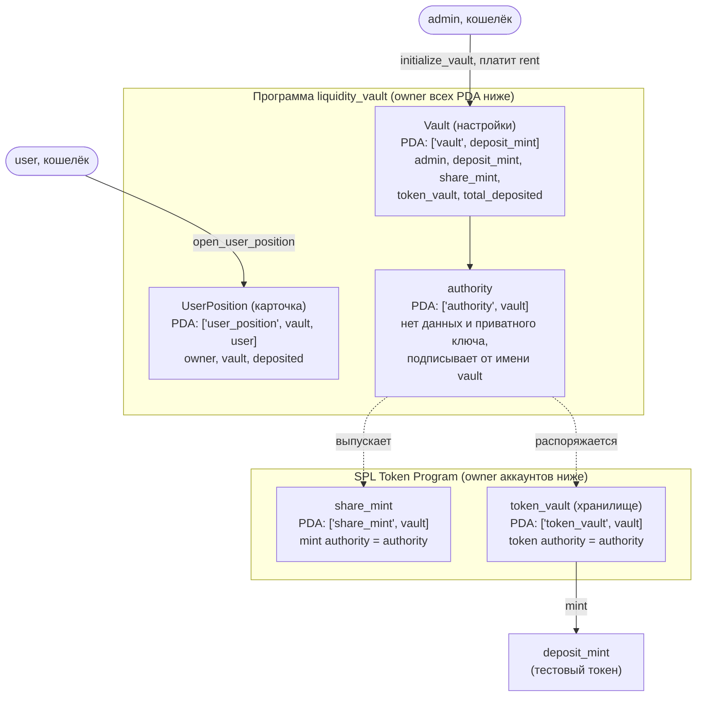

# Liquidity Vault

Учебный DeFi-vault на Solana (Anchor). Сквозной проект курса, недели 8–15.

Пользователи вносят токены в общий «котёл» и получают **share-токены**, квитанцию о своей доле. Администратор управляет стратегией (обмен на Raydium, позиция в CLMM-пуле), но **не может забрать токены**: ими владеет PDA программы.

> Работаем только в devnet и localnet. Ключи и seed-фразы в репозиторий не попадают (см. `.gitignore`).

---

## Неделя 8. Каркас vault

### Схема аккаунтов



| Аккаунт | Адрес (seeds) | Владелец (owner) | Что хранит | Зачем |
|---|---|---|---|---|
| `Vault` | `["vault", deposit_mint]` | программа vault | admin, deposit_mint, share_mint, token_vault, total_deposited, bumps | настройки и общий учёт |
| `authority` | `["authority", vault]` | System Program, без данных | — | «подпись» vault: PDA без приватного ключа, подписывать за неё может только программа (`invoke_signed`) |
| `share_mint` | `["share_mint", vault]` | Token Program | mint, mint authority = `authority` | share-токен выпускает только программа, а не человек |
| `token_vault` | `["token_vault", vault]` | Token Program | token account, authority = `authority` | физически хранит внесённые токены |
| `UserPosition` | `["user_position", vault, user]` | программа vault | owner, vault, deposited | карточка пользователя. Адрес вычисляется из адреса пользователя, поэтому список пользователей хранить не нужно |

### Инструкции

- `initialize_vault`: один раз создаёт `Vault`, `share_mint` и `token_vault`.
- `open_user_position`: пользователь создаёт свою `UserPosition`.

### Devnet

| Что | Адрес |
|---|---|
| Программа | [`oZTAvFts97FCp3ninxy5JTa57adEogs8V48PFMvstcY`](https://explorer.solana.com/address/oZTAvFts97FCp3ninxy5JTa57adEogs8V48PFMvstcY?cluster=devnet) |
| Vault (настройки) | [`EZEuHcmq7UKLjGNTJar9BYdC9LfVUqLy2oDUXZ1F8s7d`](https://explorer.solana.com/address/EZEuHcmq7UKLjGNTJar9BYdC9LfVUqLy2oDUXZ1F8s7d?cluster=devnet) |
| authority (PDA) | [`EfiKYtKRk38vz9Zttxk1H6jrVfL6MGTn2EiupGVxzJbR`](https://explorer.solana.com/address/EfiKYtKRk38vz9Zttxk1H6jrVfL6MGTn2EiupGVxzJbR?cluster=devnet) |
| Share-токен | [`9WGAAQvBABS62PzNcyuWGbgPuyPz2twF3sMndRUTW36R`](https://explorer.solana.com/address/9WGAAQvBABS62PzNcyuWGbgPuyPz2twF3sMndRUTW36R?cluster=devnet) |
| Хранилище токенов | [`H7wkWAuEQoqU7X4oFsMiDYdHwmsnT5Mir6cLezuyio17`](https://explorer.solana.com/address/H7wkWAuEQoqU7X4oFsMiDYdHwmsnT5Mir6cLezuyio17?cluster=devnet) |
| Карточка пользователя | [`9SoccM8m6bmkcdN9cFCTohWf9iLyKQgW7ypTT7YHbuvj`](https://explorer.solana.com/address/9SoccM8m6bmkcdN9cFCTohWf9iLyKQgW7ypTT7YHbuvj?cluster=devnet) |
| Тестовый токен (deposit_mint) | [`CufWmiDiJsq9JjGSK69by59X4Sou5eJDLUrG3mYfLiAK`](https://explorer.solana.com/address/CufWmiDiJsq9JjGSK69by59X4Sou5eJDLUrG3mYfLiAK?cluster=devnet) |
| Администратор | [`A8KgRCLXAqAEKrxjYr3mgforwTMXQrBKk7bEVZ8FLU6k`](https://explorer.solana.com/address/A8KgRCLXAqAEKrxjYr3mgforwTMXQrBKk7bEVZ8FLU6k?cluster=devnet) |

Транзакции:
- `initialize_vault`: [63dodX9g…rEz11v](https://explorer.solana.com/tx/63dodX9ggommShiZHJKaPpQWcCKPt1eRCAUy1LnD9XnESYkm7ff7WPJNgAK5CoFpf7kMnGdsgEHANZ3AVfrEz11v?cluster=devnet)
- `open_user_position`: [43SpFDPV…uyVp4kce](https://explorer.solana.com/tx/43SpFDPVKo5stUsbWWoVWUNDuT5kKMtUpw7VFRoF9mHSEMfJCD9Z2LVvydAZ9P5QnPgkpmFNg3HQBFTmuyVp4kce?cluster=devnet)

Тесты на localnet: `anchor test --provider.cluster localnet --validator legacy` проходят (2 passing).

### Проверьте себя

**Почему share-токен выпускает программа, а не администратор?**
Mint authority share-токена — это PDA `authority`. Если бы выпуском управлял человек, он мог бы напечатать себе share-токены и забрать чужую долю. Программа выпускает их только по правилу из кода (при депозите и строго пропорционально).

**Что такое PDA и почему у неё нет приватного ключа?**
PDA (Program Derived Address) — адрес, который вычисляется из seeds и `program_id`. Его специально подбирают так, чтобы он не лежал на кривой ed25519 (для этого нужен `bump`). Поэтому соответствующего приватного ключа не существует. «Подписать» за PDA может только программа, из которой адрес выведен, через `invoke_signed` с теми же seeds.

**Как найти карточку конкретного пользователя?**
Вычислить адрес: `PublicKey.findProgramAddressSync(["user_position", vault, user], programId)`. Хранить список пользователей не нужно.

---

## Неделя 9. Депозит и share-токены

### Правило расчёта

```
если share ещё не выпущено:  shares = amount                       (1:1)
иначе:                       shares = amount × total_shares / total_assets
```

- `total_assets`: сколько токенов сейчас лежит в `token_vault`, включая заработанное. `total_shares` — supply `share_mint`.
- Расчёт ведётся в `u128`, округление вниз в пользу vault. Код в [`math.rs`](programs/liquidity-vault/src/math.rs), там же юнит-тесты.
- Депозит 0 запрещён (`ZeroAmount`). Если share получается 0, депозит тоже отклоняется (`ZeroShares`).

### Инструкция `deposit(amount)`

1. Посчитать share **до** перевода.
2. `transfer_checked`: токены пользователя → `token_vault`. Подписывает **пользователь**.
3. `mint_to`: share-токены → ATA пользователя (создаётся при первом депозите, `init_if_needed`). Подписывает **программа** от имени PDA `authority` (`invoke_signed` с seeds `["authority", vault, bump]`).
4. Учёт: `vault.total_deposited += amount`, `user_position.deposited += amount`.

### Devnet: пример из методички

Скрипт [`scripts/week09-deposit.ts`](scripts/week09-deposit.ts) (`yarn week09`):

| Шаг | В vault | Share выпущено | Мои share | Транзакция |
|---|---|---|---|---|
| Депозит 1000 | 1000 | 1000 | 1000 | [58wd61GQ…JsUe3g](https://explorer.solana.com/tx/58wd61GQYTD819ebRH1SwshgKYbcQd7rTsS7XZDdjUGQJ6JrYRVUfj8fEEZP9tW8iF4prr2w3BzczfYYn4JsUe3g?cluster=devnet) |
| Vault «заработал» +100 (перевод в хранилище) | 1100 | 1000 | 1000 | [2DzFz5F1…C9t3VA](https://explorer.solana.com/tx/2DzFz5F11S6UgGpvWi7f9xkVts4X63be2LKYySJWfRDkxW4xnG2HLZ5WdxqSg1AE626nLQzASATXCprKN3C9t3VA?cluster=devnet) |
| Депозит 110 → **100 share** | 1210 | 1100 | 1100 | [4FcbDMu4…qTqX3QK](https://explorer.solana.com/tx/4FcbDMu4UfytsEsJUbzXEStKf5nrGs6yidpS51dT3NdUNarb9Q1cNsYFhfExAD5oZjmvmovwkPKvanvRSqTqX3QK?cluster=devnet) |

После этого `vault.total_deposited = 1110`, `user_position.deposited = 1110`. Share-токены лежат на ATA [`userShareAccount`](deployments/devnet.json).

### Проверьте себя

**Почему поздний вкладчик может получить share-токенов меньше, чем внёс токенов?**
Share — это доля котла, а не сумма. Когда vault заработал, каждый share «стоит» больше одного токена (1100 / 1000 = 1.1). Поэтому за 110 токенов дают 100 share. Иначе новичок получил бы часть дохода, который заработали до него.

**Почему перевод подписывает пользователь, а выпуск share-токенов — программа?**
Токены пользователя может двигать только их владелец, поэтому его подпись передаётся в CPI к Token Program. Mint authority share-токена — PDA `authority`, и подписать за неё может только наша программа через `invoke_signed`. Поэтому share нельзя напечатать в обход правила расчёта.

**Какие программы участвовали в транзакции депозита?** (первый депозит, `solana confirm -v`)

```
oZTAvF…stcY  (наша программа)            invoke [1]  Instruction: Deposit
  ATokenGPvb… (Associated Token Program)  invoke [2]  создание ATA для share
    Tokenkeg… (Token Program)             invoke [3]
    11111111… (System Program)            invoke [3]  выделение места под аккаунт
    Tokenkeg…                             invoke [3]
    Tokenkeg…                             invoke [3]
  Tokenkeg…   (Token Program)             invoke [2]  transfer_checked: user → token_vault
  Tokenkeg…   (Token Program)             invoke [2]  mint_to: share → user
```

Во втором депозите ATA уже есть, поэтому остаются только два вызова Token Program.

---

## Неделя 10. CPI и вывод из vault

### Инструкция `withdraw(shares)`

1. Проверить: `shares > 0` и у пользователя есть столько share (`InsufficientShares`).
2. Посчитать: `amount = shares × total_assets / total_shares` (u128, округление вниз).
3. CPI `burn`: сжечь share пользователя. Подписывает **пользователь**, его подпись передаётся дальше по цепочке.
4. CPI `transfer_checked`: `token_vault` → пользователь. Подписывает **программа** от имени PDA `authority` (`CpiContext::new_with_signer` с seeds `["authority", vault, bump]`).
5. Учёт: `deposited` уменьшается пропорционально возвращённой доле: `deposited × shares / user_shares`.

### Devnet

Скрипт [`scripts/week10-withdraw.ts`](scripts/week10-withdraw.ts) (`yarn week10`).
Транзакция: [2QcDuz1G…hdJx9AStU7z4](https://explorer.solana.com/tx/2QcDuz1Gr9MSEZeXx98pPfTjT2R8GfxYAp1JHc2mowjFYrLd7Jk5bysRFieWtmA7syvBySRY8NDRhdJx9AStU7z4?cluster=devnet)

| | В vault | Share выпущено | Мои share | Мои токены |
|---|---|---|---|---|
| до | 1210 | 1100 | 1100 | 8790 |
| после `withdraw(100 share)` | 1100 | 1000 | 1000 | 8900 (**+110**) |

Пользователь вернул 100 share и получил 110 токенов: это его доля в доходе +100 с недели 9.

### Какие CPI-вызовы видны в транзакции вывода

В Explorer, в разделе **Inner Instructions** у инструкции нашей программы `oZTAvF…stcY`, два вызова Token Program:

| # | Вызов | Кто подписал (`authority`) | Что сделано |
|---|---|---|---|
| 1 | `burn` | `A8KgRC…LU6k`, кошелёк **пользователя** | сожжено 100 share с его ATA `DYtcEM…UrzL` |
| 2 | `transferChecked` | `EfiKYt…zJbR`, **PDA authority** vault | 110 токенов из `token_vault` `H7wkWA…io17` → пользователю `7jA2Ds…Qc8P` |

Подпись PDA в транзакции не видна: её нет среди подписей. Token Program принимает `authority` как подписанта, потому что наша программа вызвала его через `invoke_signed` с правильными seeds.

### Проверьте себя

**Что такое CPI и зачем он нужен?**
Cross-Program Invocation — вызов одной программы из другой внутри той же транзакции. Наша программа сама не двигает токены: балансы хранит Token Program, и менять их может только она. Vault «просит» её сделать `transfer`, `mint_to` или `burn`. Так же на неделях 12–13 vault будет вызывать Raydium.

**Когда подписывает пользователь, а когда программа?**
Когда двигаются токены пользователя (перевод при депозите, сжигание share при выводе), подписывает пользователь. Его подпись из транзакции передаётся в CPI. Когда двигаются токены vault или выпускаются share, подписывает программа от имени PDA `authority` через `invoke_signed`.

**Почему администратор не может просто забрать токены из vault своей подписью?**
Владелец `token_vault` — PDA `authority`, а не администратор. У PDA нет приватного ключа, и подписать за неё может только наша программа. В коде программы нет инструкции, которая отдаёт токены кому-то кроме пользователя, сжигающего свои share. Тест `администратор не может забрать токены из хранилища своей подписью` проверяет это: Token Program отклоняет такой перевод с ошибкой `owner does not match`.

---

## Неделя 11. AMM и концентрированная ликвидность

Скрипт [`scripts/week11-pool.ts`](scripts/week11-pool.ts) (`yarn week11`) использует официальный Raydium SDK v2. Он устроен по образцу `raydium-sdk-V2-demo/src/clmm/createPool.ts` и `createPosition.ts`, настройка devnet лежит в [`scripts/raydium.ts`](scripts/raydium.ts).

### Тестовые токены

| Токен | Знаков | Mint | Роль |
|---|---|---|---|
| **tUSDC** | 6 | [`CufWmi…fLiAK`](https://explorer.solana.com/address/CufWmiDiJsq9JjGSK69by59X4Sou5eJDLUrG3mYfLiAK?cluster=devnet) | токен vault с недели 8 (его принимает vault) |
| **tSOL** | 9 | [`4cGUJ5…bpDbvb`](https://explorer.solana.com/address/4cGUJ55Jo9ms2aJN6xJ7hknc7vFfpRBymoZU3rbpDbvb?cluster=devnet) | второй токен пула |

Оба токена наши: mint authority — кошелёк администратора. Себе выпущено 1000 tSOL и 100 000 tUSDC. Первым токеном пула специально взят токен vault: на неделе 12 vault будет менять через этот пул часть tUSDC на tSOL.

### CLMM-пул Raydium (devnet)

| Что | Адрес / значение |
|---|---|
| Программа Raydium CLMM (devnet) | [`DRayAUgENGQBKVaX8owNhgzkEDyoHTGVEGHVJT1E9pfH`](https://explorer.solana.com/address/DRayAUgENGQBKVaX8owNhgzkEDyoHTGVEGHVJT1E9pfH?cluster=devnet) |
| **Пул tSOL/tUSDC** | [`ALEGmaWrZyPTfiwdD1hDQxnx5SEXgSjVpUfxE43dmeHM`](https://explorer.solana.com/address/ALEGmaWrZyPTfiwdD1hDQxnx5SEXgSjVpUfxE43dmeHM?cluster=devnet) |
| Fee-конфиг | [`CD4aJt…Q1qu`](https://explorer.solana.com/address/CD4aJtX11cqTCAc83nxSPkkh5JW2yjD6uwHeovjqQ1qu?cluster=devnet): комиссия **0.25%**, tickSpacing **60** |
| mintA / mintB | tSOL / tUSDC (Raydium сортирует mint по адресу) |
| Хранилища пула A / B | [`BT2TvT…miSi`](https://explorer.solana.com/address/BT2TvTxMSKcvB5JUnQdwW79TzHcMRgrdpbJVdUqwmiSi?cluster=devnet) / [`J96HTy…WAK`](https://explorer.solana.com/address/J96HTySQwiVTeZTjiotf72cKaVPggUxjFyGATwFaRWAK?cluster=devnet) |
| Observation (оракул) | [`8JrsDR…ReZS`](https://explorer.solana.com/address/8JrsDRsDraGo4gda2i445zrcALSSVQb7Rf9DvJu3ReZS?cluster=devnet) |
| Tick-array bitmap extension | [`7yfqJJ…6W3v`](https://explorer.solana.com/address/7yfqJJ1DhJM38aXqH6SyofQSxBmguhqWcd5tjnyd6W3v?cluster=devnet) |
| Транзакция создания пула | [mNapqJbv…oexy7Joi1](https://explorer.solana.com/tx/mNapqJbvFmeetvrnBfj8nfyKoeyRGiNePLLEVf9gk9mJmnDLjZ2CHPY9LhPJhchuPkHdqYQG9WU8BKoexy7Joi1?cluster=devnet) |

Все адреса для недель 12–13 сохранены в [`deployments/devnet.json`](deployments/devnet.json).

### Позиция со своего кошелька

| | |
|---|---|
| **Текущая цена пула** | **100 tUSDC за 1 tSOL** (tick −23028) |
| **Выбранный диапазон** | **90 – 110 tUSDC за tSOL** → после выравнивания по шагу 60 тиков: tick −24120 … −22080 ≈ **89.6 – 109.9** |
| Внесено | 10 tSOL + ≈1150 tUSDC |
| NFT позиции | [`8nk5VW…JJkx`](https://explorer.solana.com/address/8nk5VWQSM5S9C8rjNLpieHX4juVn8Fw1ZtamHVXUJJkx?cluster=devnet) |
| Транзакция | [4LC8CgbZ…en28LNU3x](https://explorer.solana.com/tx/4LC8CgbZZH7uRomR8VSZCJc6eiyU1HMVzjNGntYSib8FzkqsunfiessiQibpQKGxJux1AhZBdvkZ7c8en28LNU3x?cluster=devnet) |

**Почему именно ±10%.** Это правило из методички: от текущей цены отступаем вверх и вниз на величину обычного колебания за период. Для пары «SOL/USDC» ±10% — типичное недельное движение. Узкий диапазон (±1–2%) зарабатывает больше, но цена быстро из него выходит, и тогда позиция стоит без дохода. Широкий (×0.5 – ×2) спокойнее, но ликвидность «размазана» и комиссий меньше. ±10% — середина. Ещё одна практическая причина: в пуле пока только наша ликвидность. Достаточно широкий диапазон нужен, чтобы тестовые обмены на неделе 12 не выталкивали цену за его границы с первой сделки.

Почему tUSDC внесено больше, чем 10 × 100 = 1000: в CLMM пропорция зависит от того, где цена внутри диапазона, в «корневой» шкале √P. √100 ближе к √110, чем к √90 в относительных единицах, поэтому tUSDC нужно чуть больше.

### Проверьте себя

**Чем концентрированная ликвидность отличается от простого пула?**
В простом пуле (x·y = k) ликвидность распределена по всем ценам от 0 до ∞, и при обычной цене работает только малая её часть. В CLMM провайдер сам выбирает диапазон [Pa, Pb], и вся его ликвидность работает только там. Поэтому та же сумма даёт гораздо больше глубины около текущей цены и больше комиссий. Каждая позиция отдельная, со своим диапазоном. В Raydium она оформлена как NFT.

**Что происходит с позицией, когда цена выходит за её диапазон?**
Она перестаёт участвовать в обменах и зарабатывать комиссии. Пока цена шла к границе, обменщики забирали из позиции один токен и оставляли другой, поэтому за границей позиция целиком состоит из одного токена. Выше верхней границы — только tUSDC (все tSOL проданы), ниже нижней — только tSOL. Доход вернётся, когда цена вернётся в диапазон или позицию передвинут (ребалансировка).

**Почему узкий диапазон зарабатывает больше, но требует больше внимания?**
Та же сумма на меньшем отрезке цен даёт больше ликвидности L на каждый тик. Доля позиции в каждом обмене выше, поэтому и комиссий больше. Но цена выходит из узкого диапазона чаще, и каждый раз позиция перестаёт зарабатывать, пока администратор её не переставит. Это стоит комиссий сети и обменов.

---

## Запуск

```bash
yarn install
anchor build
anchor test --provider.cluster localnet --validator legacy   # тесты на solana-test-validator
anchor deploy --provider.cluster devnet
yarn week08                               # создать тестовый токен, vault и карточку в devnet
yarn week09                               # депозиты в devnet (пример 1000 → +100 → 110)
yarn week10                               # вывод 100 share в devnet
yarn week11                               # токен tSOL, CLMM-пул Raydium и позиция 90–110
```

Адреса в devnet сохраняются в [`deployments/devnet.json`](deployments/devnet.json).
